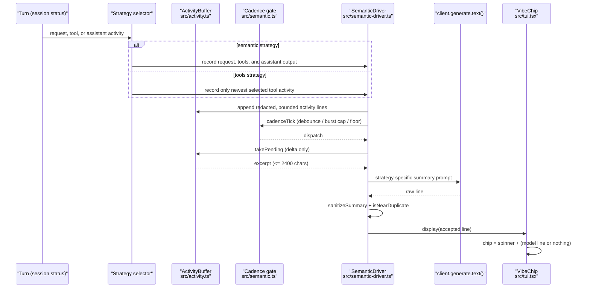

# OpenCode Working Vibes

A themed **working-vibes intent chip** for the OpenCode v2 TUI, rendered above the
composer. While the agent works it shows an animated spinner and a one-line label
describing what the turn is trying to accomplish, written by a small model, with an
optional shimmer sweep and colors resolved from the active OpenCode theme.

Ported from [`pi-working-vibes`](../pi-working-vibes) (itself adapted from the
MIT-licensed working-vibes feature in `pi-powerline-footer`). The Pi runtime glue
(extension events + `setWorkingMessage`) is replaced by an OpenCode v2 TUI slot; the
activity buffer, cadence gate, and de-duplication policy are reused.

## What it does

- Renders one line above the input box: `✳ <activity label>`.
- **Model-written labels:** the semantic layer watches the turn, sends only what is
  *new* since the last accepted line, and asks a small model for a short phrase
  (most lines are 3–6 words) describing the goal of the work. The current session's
  model is used by default; override with `/vibe model provider/model-id`.
- **Switchable strategy:** `/vibe strategy semantic` summarizes the broader turn;
  `/vibe strategy tools` asks the model to describe only the newest active tool
  activity. Both modes generate natural-language labels with the model; tool mode
  never prints raw tool names or arguments as the chip text.
- **Spinner and shimmer:** Claude Code's ten-frame asterisk spinner at 120ms, with pi's
  65ms highlight sweep, accent/dim trail, and pause between passes.
- **Model-only text:** the model is the sole writer of the chip's label in both
  strategies. Until the first model line lands, the chip shows the spinner alone.
- **Cadence, not chatter:** a 1.5s quiet period, a 2.5s cap on a continuously
  streaming turn, and a 2.5s floor between calls; an idle turn makes zero calls.
- **De-duplication:** a reworded answer is withheld instead of repainted; a `SKIP`
  consumes the delta, while a rejected answer is kept for the next call.
- **Claude Code colors:** spinner and label default to Claude Code orange
  (`#D97757`). With agent following on (the default), they track the session
  agent's mode color instead: `build` stays Claude orange, `plan` turns blue
  (`#6E9FFF`), and any agent color you define in `opencode.json` wins over both.
  Named OpenCode theme colors (`text`, `subdued`, `accent`, `success`, `warning`,
  `error`), `rainbow`, or any hex color work via `/vibe color`,
  `/vibe spinner-color`, and `/vibe agent-color <agent> <color>`; the shimmer
  sweep's highlight, accent, and dim bands still resolve from the live theme.
- Clears itself when the turn settles; shows nothing while idle.

> The label is generated from the turn's activity via the server's text-generation
> endpoint (`client.generate.text`). `src/intent.ts` only extracts the current user
> request to seed the summarizer — it never paints the chip.

## Privacy

Before anything leaves the machine, activity lines are redacted (tokens, passwords,
bearer headers, API keys), collapsed to one bounded line, and the excerpt sent to the
model is capped at 2400 characters. `bash`/`shell` commands are never sent — only
their own `description`. The excerpt contains a delta of the current turn, never the
full transcript. Set `WORKING_VIBES_DEBUG=1` to write a trace to
`~/.config/opencode/working-vibes-debug.log`.

## Install

Add the package to OpenCode's plugin list in `~/.config/opencode/opencode.json`:

```json
{
  "plugin": ["@agendy/opencode-working-vibes"]
}
```

Then install it where OpenCode resolves packages (`~/.cache/opencode`). For local
development, symlink this checkout into place:

```sh
ln -sfn "$PWD" ~/.cache/opencode/node_modules/@agendy/opencode-working-vibes
```

Restart the TUI to load the plugin. The package also ships root `index.ts` (server
entry) and `tui.ts` shims for OpenCode's `plugins/` directory discovery.

## Use

```text
/vibe                              # show current settings
  /vibe strategy semantic|tools     # choose broad activity or tool-focused narration
/vibe model provider/model-id[#variant] # override the model (default: session model)
/vibe model default                # go back to the session model
/vibe color accent                 # fixed label color (pauses agent following)
/vibe color auto                   # follow the session agent's mode color again
/vibe spinner-color accent         # fixed spinner color (same palette, pauses following)
/vibe agent-color plan "#6E9FFF"   # per-agent override (default clears it)
/vibe shimmer on|off               # animated highlight sweep across the label
```

Settings persist in the plugin's OpenCode storage and survive reloads.

## How it works



Colors resolve defensively from `context.theme`, so the chip follows whatever theme
(`vesper`, `tokyonight`, …) the TUI currently has active.

## Development

```sh
bun install
bun run typecheck
bun test
```
