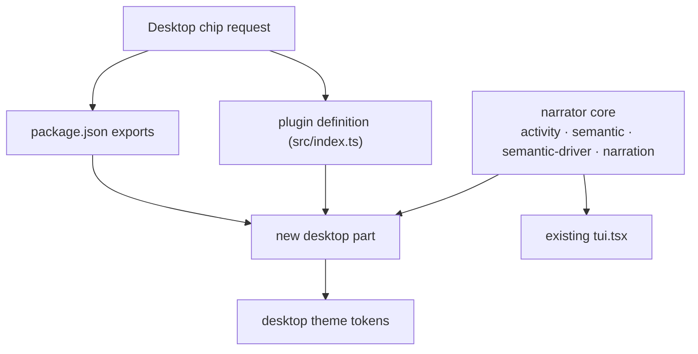
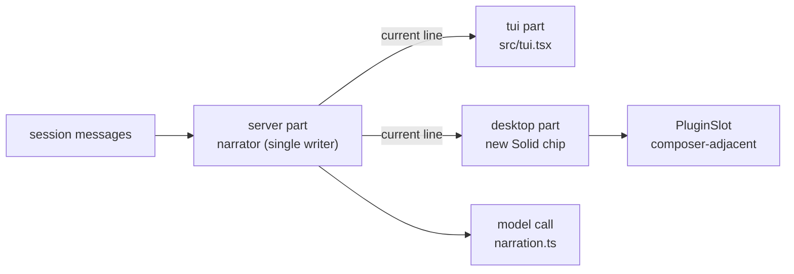
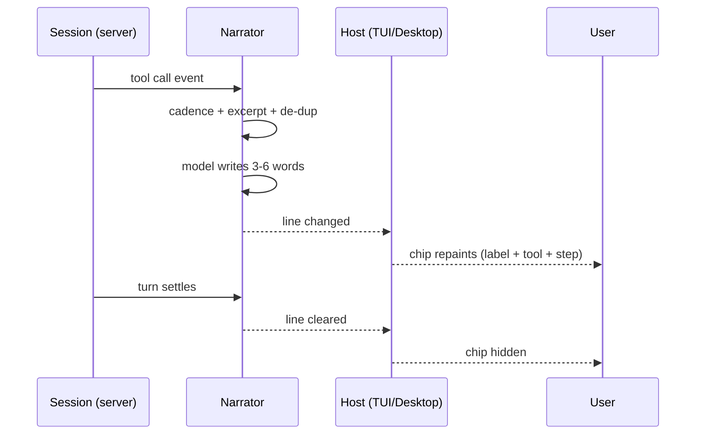
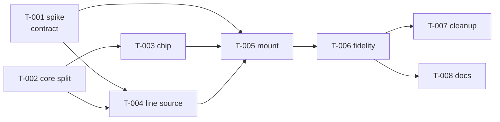

# Desktop part for @agendy/opencode-working-vibes

**Status:** Approved · **Date:** 2026-11-15 · **Agent:** spec

## Problem Statement

The working-vibes chip (spinner + model-written 3–6 word activity label above the composer) exists only in the TUI. OpenCode Desktop has a plugin system — Settings → Plugins lists plugins with `Server` and `TUI` part badges and per-plugin switches for the **desktop UI** — but this package ships no desktop part, so Desktop users see nothing while the agent works.

The user wants the same chip in Desktop, drawn from the approved design (`docs/designs/working-vibes-desktop-live-trace.html`), without forking OpenCode, patching the app bundle, or abandoning the TUI version.

## Goals

- One package, three parts: `server`, `tui`, and a new **desktop UI part** that renders the chip in Desktop.
- The desktop chip matches `docs/designs/working-vibes-desktop-live-trace.html` exactly: 34px bordered strip, spinner → label → tool chip → step, no progress bar, no timer.
- The narrator (activity → 3–6 word line) has exactly one writer and is shared by both hosts.
- The TUI behaviour does not change and its four test files keep passing.

## Non-goals

- Re-implementing the `/vibe` settings surface in Desktop.
- The shimmer direction or the composer-bound direction from `docs/designs/working-vibes-desktop.html` — rejected, not built.
- Windows/Linux desktop specifics beyond "does not crash".
- Upstreaming anything into the OpenCode repo (a separate decision, see Alternatives).

## Impact Analysis

| Layer | Impact | Complexity | Notes |
|-------|--------|------------|-------|
| Package / exports | Additive | Med | `package.json` `exports` gains the desktop entry. `files` already ships `src`. |
| Plugin definition | Modifying | Med | `src/index.ts:7` declares `define({ id: "working-vibes", tui: true, setup() {} })`. The desktop part needs its own declaration; the SDK's shape for it is unknown (see Open Decisions). |
| Narrator core | None → moved | Low | `src/activity.ts` (300 L), `src/semantic.ts` (240 L), `src/semantic-driver.ts` (242 L), `src/narration.ts` (89 L), `src/intent.ts` (23 L) are already host-agnostic — no `@opentui` or DOM imports. |
| TUI UI | None | Low | `src/tui.tsx` (696 L) keeps rendering through `@opentui/solid`; `src/color.ts` (158 L) stays TUI-side because it returns `RGBA`. |
| Desktop UI | New | High | SolidJS component, no CSS bundle — inline styles or their `@opencode/ui` components and theme tokens. |
| State | New | Med | Desktop must read turn state (working / idle / no-line-yet / interrupted) from the same place the TUI reads it. |
| Config / infra | Additive | Low | Desktop part toggled in Settings → Plugins; server part stays in `opencode.json`, TUI part in `cli.json`. |
| Tests | Additive | Med | Four existing suites (`tests/color|intent|narration|semantic.test.ts`) must keep passing; the desktop part needs its own, headless. |
| Dead code / cleanup | None | Low | Nothing becomes unreachable. `tui.ts` root shim stays. |

## Alternatives Considered

- **Chosen — desktop part inside this package.** The desktop plugin host already loads third-party plugins and lists parts per plugin, so this is the intended path. One repo, one version, one narrator, users install once.
- **New project.** Rejected: a second package would have to duplicate the narrator or depend on this one, and Desktop would need *both* installed. Adds a version-matrix for zero benefit.
- **Patch `app.asar` / local Electron fork.** Rejected as a product shape: dies on every app update, cannot be published, and would break the moment the plugin host changes. Only defensible as a 30-minute personal spike.
- **Upstream the chip into OpenCode's `gui-plugins/`.** Not rejected, deferred: it is the only path to being *built in*, but it transfers control of the desktop half and needs review. If the Open Decisions item below shows the desktop part cannot be declared by an outside package, this becomes the fallback and the spec's T-001 concludes that.
- **Separate npm package for the desktop part.** Rejected: the desktop host resolves one plugin ID; splitting would mean two IDs and two toggles.

## Library / Pattern Recommendations

- **Reuse the host's components, not hand-rolled markup.** The desktop bundles `@opencode/ui` (`Button`, `Dialog`, `Icon`, `toast`) and a token set (`--background-stronger`, `--border-weak-base`, `--text-base`, `--v2-icon-icon-accent`) — the design already uses those values. Rebuilding primitives would drift from the app.
- **Reuse the host's plugin primitives** (`PluginSlot`, `SetupContext`, `IpcClient<typeof spec>`, `ctx.t` for i18n) rather than inventing a store — the desktop's first-party plugins all work this way (`gui-plugins/src/updater/actions.tsx` is the reference).
- **Solid, not React.** The existing TUI is already `@opentui/solid`, so a Solid component is the same mental model; no new dependency.
- **One writer, N renderers.** Keep `SemanticDriver` as the single producer of the line and let hosts subscribe. `src/intent.ts` already states the rule: "the semantic layer is the only writer of the working line."
- **No new dependency for the spinner.** A CSS `rotate` animation on a 12px arc, killed under `prefers-reduced-motion`, is the whole requirement.

## Recommended Solution

Split the package by role, keep one entry per host, and make the narrator host-agnostic:

Main flow, one tool call:

Staging, so the desktop chip can ship before the narrator is relocated:

1. Extract the host-agnostic modules into `src/core/` with no behaviour change; re-point `src/tui.tsx` imports. Pure refactor, four existing suites prove it.
2. Add the desktop part against the contract found in T-001, wired to whatever channel is available. If the server part can already expose the line, subscribe; if not, run a host-local `SemanticDriver` for v1 and move it in a follow-up (accepted duplication, recorded as a shortcut).
3. Port the chip from the design file into a Solid component, using the exact measurements in `docs/designs/working-vibes-desktop-live-trace.html`.
4. Wire package exports + plugin declaration so Settings → Plugins shows the desktop part.

## Success Criteria

- [ ] `Settings → Plugins` shows `working-vibes` with a desktop part, switchable, without breaking the existing server/TUI parts.
- [ ] While a turn runs, the chip shows spinner + model-written line + tool (`read route.ts`, `bash bun test`) + step; it does not move the composer by a single pixel when the line lands.
- [ ] With no line yet, the chip shows the spinner alone at the same 34px height.
- [ ] Chip is absent when idle; interrupted turns are visibly distinct and not animated by a spinner.
- [ ] No progress bar, no elapsed clock.
- [ ] `bun test` passes: four existing suites unchanged plus new desktop-part tests.
- [ ] `bun run typecheck` clean.
- [ ] TUI output is byte-identical to today for the same session (screenshot before/after).

## In Scope / Out of Scope

**In:** `src/core/` extraction, desktop part, chip component, package exports, plugin declaration, tests, README section, design-to-code fidelity.

**Out:** settings UI in Desktop, theme authoring (`PluginThemes`), i18n beyond English strings via `ctx.t`, animation beyond the spinner, telemetry.

## Constraints & Risks

- **Runtime imports are poisoned.** `src/define.ts:1-8` documents it: opencode replaces `@opencode-ai/*` and `effect` with its own bundled copies at load time, so a locally pinned runtime import dies at import time. The desktop part must import only *types*, exactly like the TUI part does today.
- **The desktop part contract is not in the published SDK.** `@opencode-ai/plugin@0.0.0-beta-19271` exposes `Entrypoints { server, tui, rpc }` plus `host.resolve/load`; this repo pins `0.0.0-beta-17898`, whose `Plugin.Definition` has `tui:` but no desktop equivalent. The desktop app ships `@opencode/plugin/gui` types (`PluginSlot`, `SetupContext`, `IpcClient`) internally. Whether `rpc` *is* the desktop part or the desktop host resolves an unexported entry is unresolved — T-001 settles it.
- **Version skew.** Desktop ships a newer plugin SDK than the pin. Upgrading the pin may change `Plugin.Definition`; the upgrade is its own task with the TUI as the regression gate.
- **Two narrators if staging slips.** Running a driver in the desktop part while the TUI runs its own doubles model calls per turn. Acceptable for a preview, not for release.
- **Slot choice is unverified.** `window.bottom` exists, but it floats above everything; the chip belongs at the composer edge. T-001 must confirm the exact slot.
- **No design for the "line is withheld" state.** The TUI de-dups and withholds rewording; the design shows spinner-alone (pending) but not "the model said nothing this step". Ships as pending; revisit if it looks stuck in practice.

## Open Decisions

1. **How a package declares its desktop part** (blocks T-002): `rpc` entrypoint vs an unexported `gui` entry vs a `desktop: true` flag on the definition. Owner: T-001.
2. **Which slot hosts the chip** (blocks T-004): composer-adjacent slot vs `window.bottom` with layout offset.
3. **Who writes the line in v1** (blocks T-005): server part (correct, larger) vs host-local driver (ships sooner, doubles cost). Recommendation: server part if T-001 shows a channel exists, otherwise host-local with a recorded shortcut.

---

## Implementation Plan

| ID | Title | Files | Tests | Depends on | Acceptance |
|----|-------|-------|-------|------------|------------|
| T-001 | **Discovery spike — desktop-part contract.** Read the desktop plugin loader and `@opencode/plugin/gui` types; answer the three Open Decisions. Deliverable: a component that renders a coloured 34px bar in a real Desktop window, plus the resolved contract written into this spec. | throwaway `spike/` (not shipped) | none — spike | — | The bar renders in Desktop from *this* package, not a built-in; the entry shape, slot name and line channel are written down. If no outside part can load, this task stops the project and moves it to the upstream route. |
| T-002 | **Extract the narrator core.** Move `activity.ts`, `semantic.ts`, `semantic-driver.ts`, `narration.ts`, `intent.ts` to `src/core/`; re-point every import in `src/tui.tsx`, `src/index.ts`, `src/color.ts`. No behaviour change, no new API. | `src/core/*.ts`, `src/tui.tsx`, `src/index.ts`, `src/color.ts`, `src/define.ts` | existing `tests/color|intent|narration|semantic.test.ts` must pass unmodified; new `tests/core-boundary.test.ts` asserts no `@opentui` or `@opencode-ai` runtime import in `src/core/` | — | `bun test` green with the four suites untouched; `bun run typecheck` clean; TUI screenshot byte-identical. |
| T-003 | **Chip as a pure Solid component, no host wiring.** Spinner arc, label, tool chip, step. Props in, no fetching, no timers except the spinner. Left-truncating paths, reserved label row via `visibility`, `role="status"`. | `src/desktop/chip.tsx`, `src/desktop/chip.css.ts` (or inline styles) | `tests/chip.test.ts` — pure state derivation: (line, tool, step, turnState) → `{ visible, label, tool, step, spinning }` for working / pending / idle / interrupted / long-label | T-002 | Every state in the design file is reproducible from props; no `Date`, no `setInterval` outside the spinner; label never wraps. |
| T-004 | **Line source, single writer.** Subscribe the desktop part to the narrator's current line. If T-001 found a server-channel, move `SemanticDriver` into the server part and expose `{ line, tool, step, state }`; if not, run a host-local driver and record the `shortcut:` comment. | `src/index.ts`, `src/desktop/line.ts`, `src/core/semantic-driver.ts` | `tests/line.test.ts` — de-dup and withhold: identical rewording does not repaint; a settled turn clears; a second turn restarts the step count | T-001, T-002 | One narrator per session observable in logs; doubling model calls only if the shortcut branch is taken. |
| T-005 | **Mount the chip.** Register the desktop part, claim the composer-adjacent slot, wire `export` and the plugin declaration so Settings → Plugins lists a desktop part. | `package.json` (`exports`, `files`), `src/desktop/index.tsx`, `src/index.ts` | `tests/exports.test.ts` — every `exports` target resolves and its default export is a function | T-003, T-004 | Chip appears above the composer in Desktop while a turn runs; Settings → Plugins shows the part and its switch toggles the chip without touching server/TUI. |
| T-006 | **Design fidelity pass.** Match `docs/designs/working-vibes-desktop-live-trace.html` against the real window: 34px, 8px gaps, token colours, tokens not literals. | `src/desktop/chip.tsx` | manual + screenshots at 1440/768/390, both themes | T-005 | Same height in every state; zero horizontal overflow at three widths; contrast ≥4.5:1 for label/tool/step on the chip surface. |
| T-007 | **Cleanup.** If T-004 took the shortcut, remove the host-local driver once the server channel lands. Delete the spike. Delete `src/color.ts` exports nothing else uses. | `src/color.ts`, `src/desktop/line.ts`, `spike/` | full suite | T-006 | No unreachable module, no commented-out driver, spike directory gone. |
| T-008 | **Documentation.** README section: what the desktop part is, how to enable/disable it, why the narrator writes once. Add the desktop screenshots. | `README.md`, `docs/designs/*` | none | T-006 | A user can go from `npm i` to a visible chip using only the README. |

## Parallelization

- **Parallel track A:** T-002 → T-003 (pure UI, no host needed).
- **Parallel track B:** T-001 → T-004 (contract, then the line).
- **Merge point:** T-005 — the only task that needs both a rendering component and a line source, and the first one that touches the real Desktop window.
- **Sequential tail:** T-006 → T-007 / T-008 (cleanup and docs are independent of each other).
- **Gate:** T-001 can kill the plan. Do not start T-003 or T-004 work on the assumption it succeeds; if the desktop part cannot be declared by an outside package, the spec moves to the upstream route and everything below T-002 is re-scoped.

## Verification

- `bun run typecheck` clean, `bun test` green including the four pre-existing suites, unmodified.
- Manual: real Desktop window, a turn that runs ≥3 tools, then interrupt one, then let one settle. Chip appears, updates per tool, shows spinner-only before the first line, hides when idle.
- Regression: same session in the TUI before and after — screenshot compared, no diff.
- Settings → Plugins: desktop switch off ⇒ chip gone, TUI unaffected; TUI off via `cli.json` ⇒ desktop chip still works.
- Prerequisite: all implementation tasks complete.

## Open Decisions

Resolved by T-001 (2026-11-15), from the desktop app's own sources and a live check
against its server:

1. **Declaration shape — `exports["./gui-experimental"]`.** A prebuilt CommonJS
   bundle whose default export is the plugin's declarations. The host reads
   `os`/`stores`/`i18n`/`setup`/`main`, assigns the server plugin's id, and only
   needs a `setup` or `main`. `Plugin.define` is identity at runtime, so a bundle
   may export the declarations object directly. The server reports
   `features.gui: true` and serves the bundle at `GET /api/plugin/gui?id=<id>`.
   Verified: `{"features":{"server":true,"tui":true,"gui":true},"state":{"status":"active"}}`.
2. **Slot — `window.bottom`, then a DOM move.** The four slots Desktop exposes are
   `window.bottom`, `session.header`, `session.location.menu` and
   `session.panel.end`; there is no composer-adjacent slot, and `window.bottom` is
   the full-width strip *under* the composer. The part therefore registers in
   `window.bottom` and moves its own node into the composer's own column
   (`place()` in `src/desktop/chip.ts`), which puts the chip directly above the
   composer as the design draws it. The move is geometry-driven (walk up from the
   composer's `<form>` to the first ancestor wider than it) and a
   `MutationObserver` re-runs it when Desktop re-creates the composer, e.g. on a
   session switch. If no composer exists the dock stays in the slot.
3. **Writer — host-local for v1.** The GUI bundle cannot reach the TUI's narrator
   (different process), so `src/desktop/line.ts` runs its own `SemanticDriver`
   over the session's message log. Recorded as a `shortcut:` in that file: a
   session open in both hosts asks the model twice per turn. Moving the writer
   into the server part is the follow-up.

Two constraints found while resolving these:

- A GUI bundle may only `require` the host's shared modules (`effect`,
  `@opencode/plugin/gui` and its subpaths, `@opencode/client[/…]`, `solid-js[/…]`). The app
  ships **no `solid-js/jsx-runtime`**, so the desktop part cannot use JSX; it
  builds its DOM by hand.
- The bundle must be rebuilt for every change (`bun run build`); Desktop caches
  the bundle per app launch, so a new bundle needs a restart.

